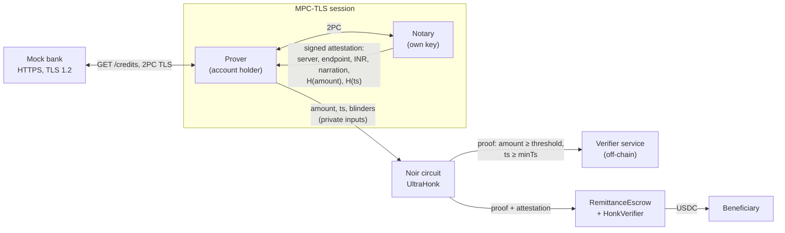

# Proof of Remittance

**Prove "₹45,000 or more landed in my bank account after time T" from the bank's own HTTPS response, without revealing the amount, the account, the UTR or the balance. A smart contract then releases USDC on that proof.**

For builders bridging a fiat rail (an INR bank credit) and an on-chain payout: off-ramps, agent treasuries, escrow. TLSNotary (MPC-TLS) notarizes the bank session, a Noir circuit proves the hidden amount clears a threshold, and a Solidity escrow checks both before paying out.

> [!WARNING]
> **Alpha, unaudited research prototype. Mock bank only.** No real bank, account or credential is used anywhere. TLSNotary itself is alpha software and says "not for production". Do not put real money behind this code. All keys in this repo are throwaway test keys, generated locally or well-known Anvil dev keys.

## Trust model in plain English

Read this before anything else. A valid proof here means:

> *A TLS server holding a certificate for `netbanking.mockbank.test` (chained to a root the notary trusts) returned, in one HTTPS response to `GET /api/v1/accounts/me/credits`, a credit object whose narration is this escrow's reference, whose currency is `INR`, whose amount is at least the threshold, and whose timestamp is after the escrow was created. A notary that saw the session (but not the amount) signed for that.*

- **You trust the notary not to collude with the prover.** In MPC-TLS, neither can forge bank data alone. Together they could fake any response. Here the notary is a single secp256k1 key fixed in the contract.
- **You trust the notary to run the template check honestly.** The notary decides which hidden bytes are "the amount of the credit with this narration". The contract cannot re-check that, because there is no on-chain TLSNotary transcript verifier.
- **You do not trust the notary with the amount.** It never sees the amount, timestamp, account, balance, UTR or session token, and the contract does not trust it for the comparison: the ZK proof does that.
- **You trust the bank.** zkTLS proves the server said X, not that X is true. It also assumes this endpoint lists only settled credits.
- **You trust the Web PKI** for the bank's domain, as a browser does.
- **The proof does not say who the prover is.** Anyone with a valid session token for the account can prove its credits.

The full list, with what is and is not defended, is in [SECURITY.md](SECURITY.md).

## What it looks like

Captured from `npm run demo` on 2026-10-05 (Apple M4, 10 cores, everything on loopback). Abridged; colors removed.

```
[4] zkTLS: prover and notary run MPC-TLS against the bank, prover discloses selectively
    MPC-TLS session + disclosure: 222 ms (setup 147, request 47, disclose 27); process wall 382 ms
    transcript: 143 B sent, 726 B received
    what the notary saw of the body (573 B, * = hidden):
    ****************************************...{"amount":"********","currency":"INR","narration":"POR-D030ED06A56D6726B772","ref":"***************","ts":**********}...
    PASS notary never saw the amount, the UTR ref, or the account number

[5] ZK predicate (Noir, UltraHonk/keccak): amount >= Rs 45,000 and ts >= minTs, values hidden
    witness 113 ms, proof 425 ms, 9024 bytes

[7] On-chain: RemittanceEscrow.release() checks notary sig + UltraHonk proof, pays the agent
    release tx 0x8009001a2fbb1a51... status=success, gas 2815099 (HonkVerifier.verify alone ~2732197)
    agent USDC: 0 -> 500
    PASS escrow #1 released 500 USDC to the agent

[8] Attacks (each must be rejected)
    PASS replay on escrow #1 -> AlreadySettled
    PASS tampered proof: verifier service -> rejected (zk: amount >= threshold, ts >= minTs)
    PASS tampered proof: on-chain HonkVerifier -> reverted: SumcheckFailed
    PASS under-threshold credit: prover cannot build a ZK proof -> error: Assertion failed: amount below threshold
    PASS under-threshold, submitting escrow #1's proof bytes instead -> ZkProofRejected
    PASS forged commitment: verifier service -> rejected (digest, notary signature)
    PASS forged commitment on-chain -> BadNotarySignature
    PASS reuse escrow #1's attestation on escrow #2 -> WrongNarration
    PASS replay escrow #1's bundle on another deployment's escrow #1 -> WrongNarration
    PASS impostor bank (untrusted CA): no attestation issued [notary] ...: REJECTED: ... certificate verification failed

ALL CHECKS PASSED
```

## Why

Moving value between a fiat rail and a chain needs someone to say "the fiat leg happened". Today that is a person reading a bank app, or a custodian. The bank already says it, in a TLS session, to the account holder. zkTLS lets the account holder carry that statement to a contract, and a ZK predicate lets them prove "at least ₹X" without publishing their bank statement. This repo is a working end-to-end version of that idea against a mock bank, with the attack cases written down and tested.

## Quickstart

Prerequisites (versions this was tested with):

| Tool | Version |
|---|---|
| Node | 22+ |
| Rust | stable (tested 1.96) |
| Foundry (`forge`, `anvil`) | 1.5.1 |
| `nargo` | `1.0.0-beta.19` (`noirup -v 1.0.0-beta.19`) |
| `bb` (Barretenberg) | `4.0.0-nightly.20260120` (`bbup -v 4.0.0-nightly.20260120`) |
| `openssl` | any recent, for the test certificates |

```bash
git clone https://github.com/agnij-dutta/proof-of-remittance.git
cd proof-of-remittance
npm ci
npm run build      # test certs, cargo (tlsn alpha.15, ~3 min cold), nargo compile + bb vk, forge build
npm run demo       # bank -> zkTLS -> ZK predicate -> verifier service -> escrow release, then the attack checks
npm test           # JS, Rust, Noir and Foundry suites
```

`npm run demo` starts Anvil, two mock banks, the notary and the verifier service on loopback ports (17047, 18443 to 18446, 18545, 18787), and stops them when it exits. Override any port with the `POR_*_PORT` variables in [.env.example](.env.example).

The Solidity verifier in `contracts/src/HonkVerifier.sol` is generated by `bb`. It must match the circuit and the `bb` version; `npm run check:verifier` regenerates it and diffs.

## Usage reference

### npm scripts

| Script | What it does |
|---|---|
| `build` | `certs`, `build:rust`, `build:circuit`, `build:contracts` |
| `certs` | Generates the throwaway test CA, bank and impostor certificates into `certs/` (gitignored) |
| `demo` | Full end-to-end run plus attacks. Exits non-zero if any check fails |
| `test` | `test:js`, `test:rust`, `test:circuit`, `test:contracts` |
| `lint` | Biome, `tsc` (checkJs strict), `cargo fmt --check`, `cargo clippy -D warnings`, `forge fmt --check`, `nargo fmt --check` |
| `format` | Applies all formatters |
| `fixture` | Copies `.run/fixture.json` from the last demo run to `contracts/test/fixtures/bundle.json` |
| `check:verifier` | Regenerates the Solidity verifier from `circuit/target/vk` and checks it matches the committed one |
| `bank` / `verifier` | Run the mock bank or the verifier service on their own |

### `prove` (prover-rs)

| Flag | Default | Meaning |
|---|---|---|
| `--notary` | `127.0.0.1:7047` | Notary address |
| `--bank` | `127.0.0.1:8443` | Bank HTTPS address (the TLS name is always `netbanking.mockbank.test`) |
| `--ca` | `certs/root_ca.der` | DER root CA the prover trusts for the bank |
| `--token` | required | Bank session token, sent as `Authorization: Bearer` and never revealed |
| `--narration` | required | Narration of the credit to prove (the escrow's `narrationFor(id)`) |
| `--out` | `out` | Output directory for `attestation.json`, `secrets.json`, `tlsn-metrics.json` |
| `--timeout` | `60` | Seconds before the session is abandoned |

`secrets.json` holds the plaintext amount, timestamp and blinders. It is what lets the prover build the ZK proof. Treat it as private.

### `notary` (prover-rs)

| Flag / env | Default | Meaning |
|---|---|---|
| `NOTARY_KEY` (env) | required | 32-byte hex secp256k1 key the notary signs with. Use a dedicated key |
| `--listen` | `127.0.0.1:7047` | Address to accept prover connections on |
| `--ca` | `certs/root_ca.der` | DER root CA the bank certificate must chain to |

### Verifier service

`POST /verify` with `{ escrow: {chainId, contract, id, thresholdPaise, minTs}, attestation, proof }` returns `{ ok, checks: [{name, ok, detail}] }`. Status 400 means a malformed request, 413 an oversized body, 500 that the verifier could not run (for example `bb` missing).

**Take `escrow` from your own records or from the chain, never from whoever submits the proof.** The service is stateless: it does not remember what it accepted, so one-payout-per-credit is your job.

### Environment variables

| Variable | Used by | Default |
|---|---|---|
| `NOTARY_KEY` | `notary` | required |
| `NOTARY_ADDRESS` | verifier service | required |
| `VERIFIER_PORT` | verifier service | `8787` |
| `BANK_PORT`, `BANK_SIM_PORT` | mock bank | `8443`, `8444` |
| `BANK_EVIL` | mock bank (`1` = impostor certificate) | unset |
| `POR_ANVIL_PORT`, `POR_BANK_PORT`, `POR_SIM_PORT`, `POR_EVIL_PORT`, `POR_EVIL_SIM_PORT`, `POR_NOTARY_PORT`, `POR_VERIFIER_PORT` | demo | `18545`, `18443`, `18444`, `18445`, `18446`, `17047`, `18787` |
| `NO_COLOR` | demo | unset |

### Contract

`RemittanceEscrow(usdc, zkVerifier, notary, serverName, endpoint)`:

- `createEscrow(beneficiary, usdcAmount, thresholdPaise, ttl) returns (id)`: pulls USDC; the credit must be at or after the creation block time.
- `narrationFor(id)`: the reference the INR payer must put on the transfer, `POR-` plus 20 hex characters of `keccak256(chainid, contract, id)`.
- `release(id, attestation, notarySig, zkProof)`: anyone may submit; funds only go to the beneficiary.
- `refund(id)`: after expiry, anyone may trigger; funds go to the depositor.

## How it works



1. **Escrow.** A depositor calls `createEscrow`. The contract records the threshold (in paise), the creation time `minTs`, and exposes `narrationFor(id)`.
2. **Fiat leg.** The payer sends INR with that narration as the transfer remark. In the demo, a simulator endpoint books the credit.
3. **MPC-TLS.** The prover and the notary jointly run the TLS client (TLSNotary 2PC) against the bank. The prover reveals the request (minus the session token), the response headers, and the credit object's keys, `currency` and `narration`. It **commits** to `amount` and `ts` as `sha256(bytes ‖ 16-byte blinder)` and hides everything else.
4. **Notary checks, then signs.** The notary verifies the certificate chain, that the request is exactly one `GET` to the expected path and host, that the response is one fully revealed `200` framed by `Content-Length`, and that the revealed bytes around the two commitments spell one credit object (rules in [`prover-rs/src/template.rs`](prover-rs/src/template.rs)). It signs `keccak256(abi.encode(version, server, endpoint, currency, narration, H(amount), H(ts), sessionTime))` with EIP-191.
5. **ZK predicate.** The Noir circuit takes the threshold, `minTs` and the two commitments as public inputs, and the plaintexts and blinders as private inputs. It opens both commitments, parses the amount as `<digits>.<2 digits>` and the timestamp as 10 digits, and asserts `amount ≥ threshold` and `ts ≥ minTs`.
6. **Release.** `RemittanceEscrow.release` checks server, endpoint, currency, the narration against `narrationFor(id)`, `sessionTime ≥ minTs`, the notary signature (low-s, `v ∈ {27, 28}`), and the UltraHonk proof with the escrow's own threshold and `minTs`. Then it marks the escrow settled and pays the beneficiary.

### Repository layout

```
bank/server.mjs              Mock bank: HTTPS (TLS 1.2) statement API + plain-HTTP credit simulator
certs/                       Generated by scripts/gen-certs.sh (gitignored); only openssl.cnf is committed
prover-rs/src/prove.rs       TLSNotary prover: MPC-TLS, reveal/commit selection, writes attestation + secrets
prover-rs/src/notary.rs      TLSNotary verifier acting as notary: cert check, template check, EIP-191 signing
prover-rs/src/template.rs    The notary's request/response template rules, unit tested with malicious transcripts
prover-rs/src/lib.rs         Attestation struct, digest (mirrors Solidity), signing, CLI flag parser
circuit/src/main.nr          Noir predicate: opens 2 SHA-256 commitments, amount ≥ threshold, ts ≥ minTs
contracts/src/               RemittanceEscrow, MockUSDC, HonkVerifier (bb-generated)
contracts/test/              Foundry tests over a captured real bundle
lib/                         Shared JS: constants and narrationFor, attestation digest, ZK proving/verifying via nargo + bb
verifier/                    verify.mjs (pure checks) and server.mjs (HTTP wrapper)
scripts/demo.mjs             End-to-end demo + attacks
test/                        node:test suites
RESEARCH.md                  zkTLS stack comparison and why TLSNotary
```

## Numbers

Measured with `npm run demo` on an Apple M4 laptop (10 cores, macOS), every process on loopback, 2026-10-04 and 2026-10-05. Ranges cover several runs, some while the machine was busy with other builds. These are **local loopback numbers**, not network numbers, and the bank is a mock.

| Step | Result |
|---|---|
| MPC-TLS session through selective disclosure | **~0.2 to 1.9 s** (MPC setup 0.1 to 1.3 s, request 0.05 to 0.3 s, disclosure 0.03 to 0.3 s). Transcript: 143 B sent, ~726 B received |
| Noir witness + UltraHonk proof (`bb`, EVM target) | **~0.1 to 0.5 s + ~0.4 to 2.1 s**. Circuit: 1,790 ACIR opcodes, ~36k gates (2 SHA-256 + parsing) |
| Proof size | **9,024 bytes**, plus 66 public inputs (2,112 bytes) |
| Off-chain verify (`bb verify`) | ~20 to 60 ms |
| On-chain `release()` | **~2.82M gas** (tx receipt on Anvil). `HonkVerifier.verify` alone ~2.73M. Foundry's in-test figure is ~3.30M |
| Deploy | HonkVerifier 5.18M gas + ZKTranscriptLib 1.33M + RemittanceEscrow 1.35M. HonkVerifier runtime is 23.7 KB, under EIP-170 with `optimizer_runs = 1` |
| Notary attestation | ~660 bytes JSON, 65-byte signature |

Loopback hides network cost. TLSNotary's own published figures for a 1 KB request / 2 KB response are about 4 s native on fiber and about 14.5 s on a cable link in MPC mode, mostly round trips between prover and notary (links in RESEARCH.md; not reproduced here). At ~2.8M gas, an L2 release costs cents; on Ethereum L1 it is several dollars at typical gas prices.

## Limitations

- **TLS 1.2 only.** TLSNotary MPC-TLS does not speak TLS 1.3. Many bank hosts still negotiate 1.2; some CDN-fronted ones will not.
- **Single notary key.** One immutable key in the contract, no rotation, no k-of-n. A compromised or colluding notary can mint any credit.
- **The template is per endpoint.** The notary knows the mock bank's JSON shape. It cannot see the JSON around the credit object, so it relies on every object of that shape in the response being a settled credit.
- **Leakage that remains.** The byte length of the amount (8 bytes means ₹10,000.00 to ₹99,999.99) and of the UTR; all response headers including `Content-Length` and `Date`; the narration; the session time. Length leakage is inherent to byte-range commitments.
- **Narration is the only link between a credit and an escrow.** Payers can mistype it, and some rails truncate or drop remarks. It is public on-chain, so never put anything personal in it.
- **No per-credit nullifier.** Each escrow has a unique narration, so one credit cannot satisfy two escrows, but nothing binds the UTR itself.
- **The off-chain verifier is stateless** and trusts its caller for the escrow terms.
- **Gas.** ~2.8M per release; fine on an L2, expensive on L1.
- **No chunked, gzip or HTML responses.** The notary refuses them.

## Path to a real bank or UPI

The hard part is not the cryptography. It is **getting a TLS 1.2 HTTPS response that contains the credit, from a session the user controls.**

- **Check TLS 1.2 first.** Run `openssl s_client -tls1_2 -connect host:443` against each candidate host and look for an ECDHE AES-128-GCM suite. If the host is 1.3-only, the options today are a proxy-model stack (Reclaim supports 1.3) or waiting for TLSNotary.
- **There is no consumer statement API.** Indian net-banking is a browser session behind login and OTP, often with device binding. The practical route is the **TLSNotary browser extension**: the user logs in normally, and the extension notarizes one XHR the bank's web app already makes (most bank SPAs fetch statement JSON from an internal API). Each bank needs a "provider": URL, headers to redact, the JSON shape of a credit, and a review of whether any other object in that response has the same shape. Expect to maintain it every time the bank ships a redesign.
- **Response size drives cost.** MPC-TLS preprocesses for `max_recv_data`. The mock response is ~726 B against a 4 KB limit; a statement page can be 50 to 500 KB. Prefer narrow endpoints such as "last N transactions" or one transaction by id.
- **UPI.** GPay, PhonePe and Paytm are mobile apps with certificate pinning, and TLSNotary has no native mobile SDK yet. Realistic sources are the payee bank's net-banking view of the credit (the UPI RRN shows up as the UTR), or a **merchant-side** API such as a Razorpay or Cashfree payment-status call made with the merchant's own key.
- **Stripe is the easiest real target.** `GET https://api.stripe.com/v1/invoices/in_...` with a test-mode secret key returns `"status":"paid"` and `"amount_paid"`. Only the template and limits need to change.
- **Account Aggregator (RBI AA framework).** The regulated, consented way to pull Indian statements as structured data. If the FIP's data carries a verifiable signature, it may replace zkTLS for banks on the AA network. Not verified here.
- **Legal and terms of service.** Automating access to a bank's internal API from the user's own session is a grey zone under most banks' terms. Get advice before shipping.

## Prior art and related work

- [TLSNotary](https://tlsnotary.org) (MPC-TLS, used here) and the Noir example in [its repo](https://github.com/tlsnotary/tlsn), which this repo's commitment-opening pattern follows.
- [zkp2p / Peer](https://docs.peer.xyz/blog/intro-zkp2p-v3): production fiat-to-crypto on payment-app proofs, with a TEE that re-signs TLSNotary, Reclaim or Primus proofs as EIP-712 attestations.
- [Reclaim Protocol](https://github.com/reclaimprotocol/attestor-core): proxy-model zkTLS with TLS 1.3 and an on-chain witness-set verifier.
- Opacity, vlayer, zkPass and Primus: compared in [RESEARCH.md](RESEARCH.md).

What this repo adds: a hidden **numeric predicate** (amount ≥ threshold, timestamp ≥ escrow creation) proven in ZK over TLSNotary's hash commitments and verified on-chain, a notary template that refuses the request-smuggling and splicing shapes a malicious prover can produce, an escrow reference that is domain-separated per chain and contract, and the attacks as executable tests.

## Roadmap

- k-of-n notaries (or a TEE notary) instead of a single trusted key, with key rotation.
- EIP-712 typed attestations instead of EIP-191 over a custom digest.
- A per-credit nullifier: commit to the UTR and expose a hash of it from the circuit, so rails that drop remarks can still bind one credit to one payout.
- Move the template check on-chain or into a circuit once TLSNotary attestations can be verified outside the notary.
- Chunked transfer-encoding, gzip and HTML statement pages.
- Browser-extension prover flow for a real net-banking session, and a Stripe test-mode provider as the first real endpoint.
- Gas: try `bb write_solidity_verifier --optimized`, or wrap in Groth16 (~250k to 300k gas).
- Solana: UltraHonk verification there would need a Groth16 wrapper or another verifier.
- Plug into an on-chain agent spend mandate: "₹X landed, so the agent's USDC ceiling rises by the equivalent", with an FX rate oracle.

## Contributing, license, author

See [CONTRIBUTING.md](CONTRIBUTING.md). Report security issues privately as described in [SECURITY.md](SECURITY.md).

MIT licensed, see [LICENSE](LICENSE).

Built by Agnij Dutta ([@0xholmesdev](https://x.com/0xholmesdev), [github.com/agnij-dutta](https://github.com/agnij-dutta)).
